<p align="center"></p>

<h1 align="center">TIKAZ Knowledge & Research for Codex</h1>
<p align="center"><strong>Traceable research and decisions with evidence ledgers, disagreement, confidence, and knowledge feedback.</strong></p>
<p align="center"><a href="https://github.com/TIKAZI/TIKAZ-Codex-Knowledge-Research/actions/workflows/validate.yml"></a> <a href="LICENSE"></a> </p>
<p align="center"><a href="https://github.com/TIKAZI/TIKAZ-AI-Skills">← Explore all six TIKAZ AI Skills for Codex suites</a></p>

---

## One suite, ready to install

This repository is the independently installable **knowledge-research** distribution from [TIKAZ AI Skills for Codex](https://github.com/TIKAZI/TIKAZ-AI-Skills). The monorepo is the canonical development source; this repository is automatically synchronized and optimized for people who need only this workflow.

Designed, integrated, refactored, and continuously maintained by **TIKAZ**; community contributions are welcome. This is an independent project, not an OpenAI-official repository.

This repository is an automatically synchronized distribution of the canonical [TIKAZ-AI-Skills](https://github.com/TIKAZI/TIKAZ-AI-Skills) monorepo. Cross-suite issues and source changes belong in the canonical repository.

## What makes it different

- **Question and evidence threshold are fixed before synthesis**
- **Conversion, retrieval, evidence, inference, and recommendation remain distinct**
- **Personal knowledge is adopted only when it changes execution**

## Install

Clone or download this repository, then copy the repository folder into the Skill directory supported by your Codex environment. The root `SKILL.md` is the suite orchestrator; child folders are focused Skills that can also be installed separately.

```bash
git clone https://github.com/TIKAZI/TIKAZ-Codex-Knowledge-Research.git
```

## Try it

```text
Compare these papers with inclusion criteria, contrary evidence, confidence, and claims that need revalidation.
```

```text
Convert this document to Markdown, inspect fidelity, then extract decision-ready claims without inventing citations.
```

```text
Retrieve relevant personal project decisions and record only knowledge that materially changes the plan.
```

## How the suite works

Read [SKILL.md](SKILL.md) for the owning workflow, [references/routing.md](references/routing.md) for specialist routing, and [references/output-contract.md](references/output-contract.md) for the verified handoff. Optional tools are detected at runtime; local login state or machine-specific software is never promised as universally available.

## Repository structure

```text
./
├─ SKILL.md                 # suite orchestrator
├─ agents/                  # Codex UI metadata
├─ references/              # routing and output contract
├─ <child-skill>/           # independently installable specialists
├─ DISTRIBUTION.yml         # canonical source and sync metadata
└─ scripts/                 # deterministic validation
```

## Canonical source and contributions

Development, source review, and cross-suite architecture live in [TIKAZ-AI-Skills](https://github.com/TIKAZI/TIKAZ-AI-Skills). This distribution synchronizes from `suites/knowledge-research` every week and can also be refreshed manually through GitHub Actions.

Source modes, observed licenses, and concrete TIKAZ contributions are recorded in [SOURCES.yml](SOURCES.yml) and [THIRD_PARTY_NOTICES.md](THIRD_PARTY_NOTICES.md). TIKAZ-authored files are released under the [MIT License](LICENSE).
